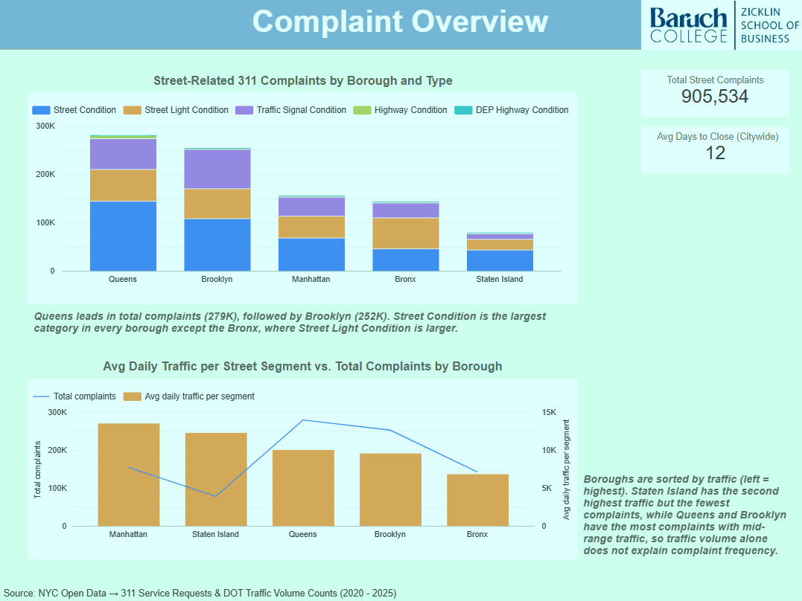
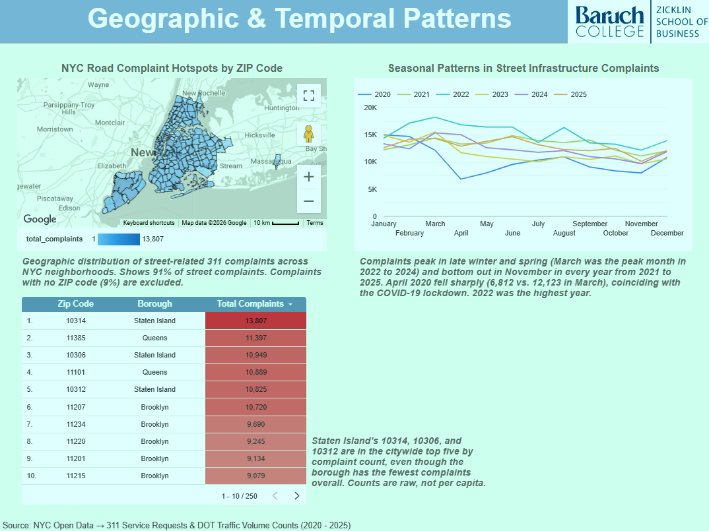

## Dashboard

The interactive Looker Studio dashboard below brings together all nine analytics
queries into a unified view across three pages: Complaint Overview, Response Time
Analysis, and Geographic & Temporal Patterns.

> 🔗 **[Open dashboard in Looker Studio](https://datastudio.google.com/reporting/b7835c43-9acb-4aa1-9cd6-e9230b5421d8)**  

---

## Dashboard Pages

### Page 1: Complaint Overview

Addresses **Question 1**: Does traffic volume correlate with complaint frequency?

::: {layout-ncol=1}
{fig-alt="Dashboard page 1: Complaint Overview"}
:::

**Key findings:**

- Queens leads in total complaints (279,093), followed by Brooklyn (252,399), Manhattan
  (154,282), the Bronx (141,874), and Staten Island (77,886)
- Manhattan has the highest average daily traffic (about 13,500 vehicles per counted
  street segment per day) but ranks 3rd in complaints. Staten Island ranks 2nd in
  traffic with the fewest complaints, and Queens has the most complaints with the 3rd
  highest traffic. The traffic ranking (Manhattan, Staten Island, Queens, Brooklyn,
  Bronx) does not match the complaint ranking, so traffic volume alone does not
  predict complaint frequency
- Borough traffic averages rest on few counts (178 segment-days in Staten Island,
  739 in Manhattan, 1,454 in Brooklyn), so the traffic ranking should be read with caution
- Street Condition and Street Light Condition account for the majority of complaints
  across all boroughs

### Page 2: Response Time Analysis

Addresses **Question 2** and the **T2R KPI**: Does response time vary across boroughs,
and does higher traffic lead to longer repair times?

::: {layout-ncol=1}
{fig-alt="Dashboard page 2: Response Time Analysis"}
:::

**Key findings:**

- Brooklyn has the slowest avg response time (14.1 days); Staten Island the fastest
  (6.8 days). Manhattan (13.4), Queens (12.8), and the Bronx (10.4) fall in between
- Queens has the most complaints (279,093) but ranks 3rd in response time (12.8 days),
  so a high complaint volume does not by itself mean slower closure
- **Peak-Load Service Lag KPI:** Avg days to close is **12.66 days** in peak traffic
  months and **12.69 days** in non-peak months, and the median is 1 day in both groups.
  We found no difference. Peak months are defined with a within-segment traffic index
  (see Query 9), and months with fewer than 30 segment-days of counts are excluded
- The T2R dual-axis chart shows no consistent pattern across the five boroughs.
  Staten Island has the 2nd highest traffic and the fastest closure, Manhattan has the
  highest traffic and the 2nd slowest closure, Brooklyn (4th in traffic) is the slowest,
  and the Bronx (lowest traffic) is the 2nd fastest. With five data points this is
  descriptive, not a statistical test

### Page 3: Geographic & Temporal Patterns

Shows **where** street complaints concentrate (ZIP code) and **when** they are filed (seasonal pattern).

::: {layout-ncol=1}
{fig-alt="Dashboard page 3: Geographic & Temporal Patterns"}
:::

**Key findings:**

- The ZIP codes with the most street complaints are 10314 (Staten Island, 13,807),
  11385 (Queens, 11,397), 10306 (Staten Island, 10,949), 11101 (Queens, 10,889), and
  10312 (Staten Island, 10,825). Three of the top five ZIP codes are in Staten Island,
  the borough with the fewest complaints overall
- These are raw counts. We have no population or street-mile denominator, so they show
  where complaints are concentrated, not which areas have the worst roads
- 91.2% of street complaints (825,575) have a valid ZIP code and appear on the map.
  8.6% (78,254) have no ZIP code and 0.2% (1,705) carry the invalid placeholder
  "10000"; both groups are excluded from the map
- Complaints tend to peak in late winter and spring (March was the peak month in 2022,
  2023, and 2024) and reach their lowest point in November in every year from 2021 to 2025
- 2022 was the highest year (182,006 complaints) and 2020 the lowest (123,410), with a
  sharp drop in April 2020 (6,812 vs. 12,123 in March) that coincides with the COVID-19
  lockdown

---

## SQL Queries

All queries were run in BigQuery against the `raul-cis-9440-spring2026.group_3_marts`
dataset. Each `CREATE TABLE` version persists results as a mart table used directly
by Looker Studio.

> 🔗 **[Full SQL file on GitHub](https://github.com/RaulSolaNavarro/nyc-analytics-project-rjsn)**
> or see `queries/milestone5_queries.sql` in this repository.

---

### Method notes

Four checks shaped the final queries:

1. **ZIP-level counts must reconcile to borough totals.** `dim_incident_location`
   has repeated `incident_location_key` values, which duplicated complaints when the
   fact table was joined to it. Query 6 collapses the dimension to one row per key
   first. The corrected ZIP table totals 825,575 complaints, below the 905,534
   borough total because null and "10000" ZIP codes are excluded.
2. **Traffic is measured per street segment per day.** The DOT counts only a few
   segments per borough on a given day (about 2.0 to 2.6 on average), so summing
   all counts in a borough-day mostly measures how many segments were counted.
   Queries 4, 5, 7, and 9 first sum `vol` to the segment-day, then average.
3. **`complaints_per_million_vehicles` was removed.** Its denominator reflected
   counting effort, not traffic, and produced extreme outliers in sparse months.
   Query 5 now reports monthly complaints next to average daily traffic per segment.
4. **The analysis window is 2020 to 2025.** The warehouse also holds complaints created
   in 2026 (38,861 street-related complaints) and some 2026 traffic counts. Every query
   now filters to 2020 through 2025, so all totals describe the same period.

---

### Query 1: Complaints by Borough and Problem Type

**Aggregation:** borough × problem type  
**Purpose:** Baseline complaint counts per borough → the foundation for cross-mart
comparison with traffic volume.

```sql
SELECT
    l.borough                                           AS borough,
    p.problem_type                                      AS problem_type,
    COUNT(*)                                            AS total_complaints
FROM `raul-cis-9440-spring2026.group_3_marts.fact_311service_request` f
INNER JOIN `raul-cis-9440-spring2026.group_3_marts.dim_location` l
    ON f.location_id = l.location_key
INNER JOIN `raul-cis-9440-spring2026.group_3_marts.dim_problem` p
    ON f.problem_id = p.problem_key
INNER JOIN `raul-cis-9440-spring2026.group_3_marts.dim_date` d
    ON f.created_date_id = d.date_key
WHERE p.problem_type IN (
    'Street Condition',
    'Street Light Condition',
    'Traffic Signal Condition',
    'Highway Condition',
    'DEP Highway Condition'
)
  AND d.year BETWEEN 2020 AND 2025
GROUP BY l.borough, p.problem_type
ORDER BY total_complaints DESC;
```

---

### Query 2: Avg Response Time (Days to Close) by Borough

**Aggregation:** borough  
**Purpose:** Answers Q2: Does borough response time vary? Uses two CTE date joins
to compute `DATE_DIFF` between `created_date` and `closed_date`.

```sql
WITH created_dates AS (
    SELECT
        f.unique_key,
        f.location_id,
        f.problem_id,
        d.full_date                                     AS created_date
    FROM `raul-cis-9440-spring2026.group_3_marts.fact_311service_request` f
    INNER JOIN `raul-cis-9440-spring2026.group_3_marts.dim_date` d
        ON f.created_date_id = d.date_key
    WHERE d.year BETWEEN 2020 AND 2025
),
closed_dates AS (
    SELECT
        f.unique_key,
        d.full_date                                     AS closed_date
    FROM `raul-cis-9440-spring2026.group_3_marts.fact_311service_request` f
    INNER JOIN `raul-cis-9440-spring2026.group_3_marts.dim_date` d
        ON f.closed_date_id = d.date_key
)
SELECT
    l.borough,
    COUNT(*)                                            AS total_closed_requests,
    ROUND(AVG(DATE_DIFF(cl.closed_date,
              cr.created_date, DAY)), 2)                AS avg_days_to_close,
    MIN(DATE_DIFF(cl.closed_date,
        cr.created_date, DAY))                          AS min_days_to_close,
    MAX(DATE_DIFF(cl.closed_date,
        cr.created_date, DAY))                          AS max_days_to_close
FROM created_dates cr
INNER JOIN closed_dates cl      ON cr.unique_key = cl.unique_key
INNER JOIN `raul-cis-9440-spring2026.group_3_marts.dim_location` l
    ON cr.location_id = l.location_key
INNER JOIN `raul-cis-9440-spring2026.group_3_marts.dim_problem` p
    ON cr.problem_id = p.problem_key
WHERE p.problem_type IN (
    'Street Condition', 'Street Light Condition',
    'Traffic Signal Condition', 'Highway Condition', 'DEP Highway Condition'
)
  AND cl.closed_date >= cr.created_date   -- exclude data anomalies
GROUP BY l.borough
ORDER BY avg_days_to_close DESC;
```

---

### Query 3: Monthly Complaint Trends by Year

**Aggregation:** year × month  
**Purpose:** Identifies seasonal patterns in street infrastructure complaints.
Used in cross-mart comparison with monthly traffic volume (Query 5).

```sql
SELECT
    d.year                                              AS complaint_year,
    d.month                                             AS complaint_month,
    COUNT(*)                                            AS total_complaints
FROM `raul-cis-9440-spring2026.group_3_marts.fact_311service_request` f
INNER JOIN `raul-cis-9440-spring2026.group_3_marts.dim_date` d
    ON f.created_date_id = d.date_key
INNER JOIN `raul-cis-9440-spring2026.group_3_marts.dim_problem` p
    ON f.problem_id = p.problem_key
WHERE p.problem_type IN (
    'Street Condition', 'Street Light Condition',
    'Traffic Signal Condition', 'Highway Condition', 'DEP Highway Condition'
)
  AND d.year BETWEEN 2020 AND 2025
GROUP BY d.year, d.month
ORDER BY d.year, d.month;
```

---

### Query 4: Avg Daily Traffic per Street Segment by Borough

**Aggregation:** borough  
**Purpose:** Computes the borough-level average daily traffic from the 15-minute
interval counts. Counts are first summed to one value per street segment per day,
then averaged by borough. The result reads as "vehicles counted per segment per day."
Used as the traffic side of the cross-mart comparison.

```sql
WITH segment_day AS (
    SELECT
        f.location_id                                   AS location_id,
        f.segment_id                                    AS segment_id,
        d.full_date                                     AS traffic_date,
        SUM(f.vol)                                      AS daily_vol
    FROM `raul-cis-9440-spring2026.group_3_marts.fact_traffic_volume` f
    INNER JOIN `raul-cis-9440-spring2026.group_3_marts.dim_date` d
        ON f.date_id = d.date_key
    WHERE d.year BETWEEN 2020 AND 2025
    GROUP BY f.location_id, f.segment_id, d.full_date
)
SELECT
    l.borough                                           AS borough,
    COUNT(DISTINCT sd.traffic_date)                     AS days_measured,
    COUNT(*)                                            AS segment_days_measured,
    ROUND(AVG(sd.daily_vol), 0)                         AS avg_daily_traffic_volume
FROM segment_day sd
INNER JOIN `raul-cis-9440-spring2026.group_3_marts.dim_location` l
    ON sd.location_id = l.location_key
GROUP BY l.borough
ORDER BY avg_daily_traffic_volume DESC;
```

**Result (2020 to 2025):** Manhattan 13,496 (739 segment-days); Staten Island 12,258 (178); Queens 10,007 (1,179); Brooklyn 9,547 (1,454); Bronx 6,806 (639). Averages rest on few counts, so the ranking is sensitive to which segments were counted.

---

### Query 5: Monthly Traffic vs. Complaints (Cross-Mart) ⭐

**Aggregation:** borough × year × month  
**Cross-mart:** Joins `fact_traffic_volume` + `fact_311service_request` via conformed
`Dim_Date` and `Dim_Location`.  
**Purpose:** Core cross-mart query. Places monthly street complaints next to the
monthly average of daily traffic per segment for each borough. The earlier
`complaints_per_million_vehicles` ratio was removed because its denominator reflected
how many segments were counted in a month, not how busy the roads were.

```sql
WITH segment_day AS (
    SELECT
        f.location_id                                   AS location_id,
        f.segment_id                                    AS segment_id,
        f.date_id                                       AS date_id,
        SUM(f.vol)                                      AS daily_vol
    FROM `raul-cis-9440-spring2026.group_3_marts.fact_traffic_volume` f
    GROUP BY f.location_id, f.segment_id, f.date_id
),
monthly_traffic AS (
    SELECT
        l.borough,
        d.year,
        d.month,
        ROUND(AVG(sd.daily_vol), 0)                     AS avg_daily_traffic_per_segment
    FROM segment_day sd
    INNER JOIN `raul-cis-9440-spring2026.group_3_marts.dim_date` d
        ON sd.date_id = d.date_key
    INNER JOIN `raul-cis-9440-spring2026.group_3_marts.dim_location` l
        ON sd.location_id = l.location_key
    WHERE d.year BETWEEN 2020 AND 2025
    GROUP BY l.borough, d.year, d.month
),
monthly_complaints AS (
    SELECT
        l.borough,
        d.year,
        d.month,
        COUNT(*)                                        AS monthly_complaints
    FROM `raul-cis-9440-spring2026.group_3_marts.fact_311service_request` f
    INNER JOIN `raul-cis-9440-spring2026.group_3_marts.dim_date` d
        ON f.created_date_id = d.date_key
    INNER JOIN `raul-cis-9440-spring2026.group_3_marts.dim_location` l
        ON f.location_id = l.location_key
    INNER JOIN `raul-cis-9440-spring2026.group_3_marts.dim_problem` p
        ON f.problem_id = p.problem_key
    WHERE p.problem_type IN (
        'Street Condition', 'Street Light Condition',
        'Traffic Signal Condition', 'Highway Condition', 'DEP Highway Condition'
    )
      AND d.year BETWEEN 2020 AND 2025
    GROUP BY l.borough, d.year, d.month
)
SELECT
    mt.borough,
    mt.year,
    mt.month,
    mt.avg_daily_traffic_per_segment,
    mc.monthly_complaints                               AS monthly_street_complaints
FROM monthly_traffic mt
INNER JOIN monthly_complaints mc
    ON mt.borough = mc.borough
   AND mt.year    = mc.year
   AND mt.month   = mc.month
ORDER BY mt.borough, mt.year, mt.month;
```

Borough-months with no DOT traffic counts do not appear in this result.

---

### Query 6: Complaints by ZIP Code (Choropleth Map)

**Aggregation:** zip code × borough × problem type  
**Purpose:** Provides ZIP-code-level complaint counts for the choropleth map in
Looker Studio, enabling geographic analysis beyond borough level.  
**Note:** `dim_incident_location` contains repeated `incident_location_key` values,
so it is collapsed to one row per key before the join. Without this step each
complaint was counted once per repeated row and the ZIP totals exceeded the borough
totals. Complaints with a null ZIP or the placeholder "10000" are excluded.

```sql
CREATE OR REPLACE TABLE
  `raul-cis-9440-spring2026.group_3_marts.complaints_by_zip_code`
AS
SELECT
    il.zip_code,
    l.borough,
    p.problem_type,
    COUNT(*)                                            AS total_complaints
FROM `raul-cis-9440-spring2026.group_3_marts.fact_311service_request` f
INNER JOIN (
    -- dim_incident_location has duplicate keys (same ZIP on every copy),
    -- so collapse to one row per key before joining
    SELECT
        incident_location_key,
        ANY_VALUE(zip_code)                             AS zip_code
    FROM `raul-cis-9440-spring2026.group_3_marts.dim_incident_location`
    GROUP BY incident_location_key
) il
    ON f.incident_location_id = il.incident_location_key
INNER JOIN `raul-cis-9440-spring2026.group_3_marts.dim_location` l
    ON f.location_id = l.location_key
INNER JOIN `raul-cis-9440-spring2026.group_3_marts.dim_problem` p
    ON f.problem_id = p.problem_key
INNER JOIN `raul-cis-9440-spring2026.group_3_marts.dim_date` d
    ON f.created_date_id = d.date_key
WHERE p.problem_type IN (
    'Street Condition', 'Street Light Condition',
    'Traffic Signal Condition', 'Highway Condition', 'DEP Highway Condition'
)
  AND d.year BETWEEN 2020 AND 2025
  AND il.zip_code IS NOT NULL
  AND il.zip_code != '10000'   -- placeholder, not a real ZIP code
GROUP BY il.zip_code, l.borough, p.problem_type
ORDER BY total_complaints DESC;
```

**Reconciliation:** the table totals 825,575 complaints. Adding 78,254 null-ZIP and
1,705 "10000" complaints gives 905,534, which matches the borough total from Query 1.

---

### Query 7: Combined Traffic vs. Complaints by Borough (Cross-Mart) ⭐

**Aggregation:** borough  
**Cross-mart:** Combines `fact_traffic_volume` + `fact_311service_request`.  
**Purpose:** Single borough-level table for the dual-axis dashboard chart that
directly addresses Q1. Traffic uses the same segment-day grain as Query 4.

```sql
CREATE OR REPLACE TABLE
  `raul-cis-9440-spring2026.group_3_marts.complaints_vs_traffic_by_borough`
AS
WITH segment_day AS (
    SELECT
        f.location_id                                   AS location_id,
        f.segment_id                                    AS segment_id,
        f.date_id                                       AS date_id,
        SUM(f.vol)                                      AS daily_vol
    FROM `raul-cis-9440-spring2026.group_3_marts.fact_traffic_volume` f
    INNER JOIN `raul-cis-9440-spring2026.group_3_marts.dim_date` d
        ON f.date_id = d.date_key
    WHERE d.year BETWEEN 2020 AND 2025
    GROUP BY f.location_id, f.segment_id, f.date_id
),
traffic AS (
    SELECT
        l.borough,
        ROUND(AVG(sd.daily_vol), 0)                     AS avg_daily_traffic_volume
    FROM segment_day sd
    INNER JOIN `raul-cis-9440-spring2026.group_3_marts.dim_location` l
        ON sd.location_id = l.location_key
    GROUP BY l.borough
),
complaints AS (
    SELECT
        l.borough,
        COUNT(*)                                        AS total_complaints
    FROM `raul-cis-9440-spring2026.group_3_marts.fact_311service_request` f
    INNER JOIN `raul-cis-9440-spring2026.group_3_marts.dim_location` l
        ON f.location_id = l.location_key
    INNER JOIN `raul-cis-9440-spring2026.group_3_marts.dim_problem` p
        ON f.problem_id = p.problem_key
    INNER JOIN `raul-cis-9440-spring2026.group_3_marts.dim_date` d
        ON f.created_date_id = d.date_key
    WHERE p.problem_type IN (
        'Street Condition', 'Street Light Condition',
        'Traffic Signal Condition', 'Highway Condition', 'DEP Highway Condition'
    )
      AND d.year BETWEEN 2020 AND 2025
    GROUP BY l.borough
)
SELECT
    t.borough,
    t.avg_daily_traffic_volume,
    c.total_complaints
FROM traffic t
INNER JOIN complaints c ON t.borough = c.borough
ORDER BY t.avg_daily_traffic_volume DESC;
```

---

### Query 8: Traffic-to-Repair Correlation (T2R) by Borough ⭐

**Aggregation:** borough  
**Cross-mart:** Joins `complaints_vs_traffic_by_borough` + `response_time_by_borough`  
**Purpose:** Directly addresses the **T2R KPI**: Does higher traffic volume go with
slower repair times? Computes two derived metrics: `traffic_per_repair_day`
(traffic absorbed per repair day) and `complaints_per_repair_day` (repair throughput).
Powers the dual-axis T2R chart on the Response Time Analysis dashboard page. Run it
after Queries 2 and 7, since it reads the tables they build. With five boroughs it is
a descriptive comparison, not a statistical test.

```sql
CREATE OR REPLACE TABLE
  `raul-cis-9440-spring2026.group_3_marts.traffic_to_repair_correlation`
AS
SELECT
    t.borough,
    t.avg_daily_traffic_volume,
    t.total_complaints,
    r.avg_days_to_close,
    r.total_closed_requests,
    -- T2R metric: does higher traffic go with longer repair time?
    ROUND(t.avg_daily_traffic_volume /
          NULLIF(r.avg_days_to_close, 0), 2)            AS traffic_per_repair_day,
    -- Complaint resolution rate: complaints per day to close
    ROUND(t.total_complaints /
          NULLIF(r.avg_days_to_close, 0), 2)            AS complaints_per_repair_day
FROM `raul-cis-9440-spring2026.group_3_marts.complaints_vs_traffic_by_borough` t
INNER JOIN `raul-cis-9440-spring2026.group_3_marts.response_time_by_borough` r
    ON t.borough = r.borough
ORDER BY avg_daily_traffic_volume DESC;
```

---

### Query 9: Peak-Load Service Lag KPI ⭐

**Aggregation:** traffic period (Peak vs. Non-Peak months)  
**Cross-mart:** Joins `fact_traffic_volume` + `fact_311service_request` + `dim_date` + `dim_problem`  
**Purpose:** Directly addresses the **Peak-Load Service Lag KPI**: Does avg time to
close 311 complaints increase during months with above-average traffic? Each street
segment is compared with its own average daily volume (a traffic index, where 1.0 is a
typical day for that segment). A month is "Peak" when its average index is above the
mean index across qualifying months in 2020 to 2025.

**Why an index:** the DOT counts only a few segments per month, so average raw volume
swings with which segments were counted (for example, 31,046 in April 2023 vs. 5,983 in
May 2023). The index removes that effect. Months with fewer than 30 segment-days of
counts are excluded because a single segment can flip their label.

**Finding:** Peak months average **12.66 days** to close and non-peak months
**12.69 days** (median 1 day in both). We observed no difference. The comparison is
descriptive: no significance test was run and traffic counts are sparse, so this
shows no evidence of a peak-load lag, not proof that none exists. (A first version
using raw citywide volume showed 13.97 vs. 11.40 days, but that split was driven by
which segments were counted.)

```sql
CREATE OR REPLACE TABLE
  `raul-cis-9440-spring2026.group_3_marts.peak_load_service_lag`
AS
WITH segment_day AS (
    SELECT f.segment_id, f.date_id, SUM(f.vol)          AS daily_vol
    FROM `raul-cis-9440-spring2026.group_3_marts.fact_traffic_volume` f
    GROUP BY f.segment_id, f.date_id
),
segment_avg AS (
    -- each segment's own typical daily volume
    SELECT segment_id, AVG(daily_vol)                   AS seg_avg
    FROM segment_day
    GROUP BY segment_id
),
monthly_index AS (
    -- 1.0 = counted segments at their own average; above 1.0 = busier than usual
    SELECT
        d.year,
        d.month,
        AVG(sd.daily_vol / NULLIF(sa.seg_avg, 0))       AS traffic_index,
        COUNT(*)                                        AS segment_days
    FROM segment_day sd
    INNER JOIN segment_avg sa ON sd.segment_id = sa.segment_id
    INNER JOIN `raul-cis-9440-spring2026.group_3_marts.dim_date` d
        ON sd.date_id = d.date_key
    WHERE d.year BETWEEN 2020 AND 2025
    GROUP BY d.year, d.month
    HAVING COUNT(*) >= 30   -- drop months with too few counts to trust
),
peak_months AS (
    SELECT
        year,
        month,
        CASE
            WHEN traffic_index > (SELECT AVG(traffic_index) FROM monthly_index)
            THEN 'Peak'
            ELSE 'Non-Peak'
        END                                             AS traffic_period
    FROM monthly_index
),
response_times AS (
    SELECT
        cd.year,
        cd.month,
        DATE_DIFF(cl.full_date, cd.full_date, DAY)      AS days_to_close
    FROM `raul-cis-9440-spring2026.group_3_marts.fact_311service_request` f
    INNER JOIN `raul-cis-9440-spring2026.group_3_marts.dim_date` cd
        ON f.created_date_id = cd.date_key
    INNER JOIN `raul-cis-9440-spring2026.group_3_marts.dim_date` cl
        ON f.closed_date_id = cl.date_key
    INNER JOIN `raul-cis-9440-spring2026.group_3_marts.dim_problem` p
        ON f.problem_id = p.problem_key
    WHERE p.problem_type IN (
        'Street Condition', 'Street Light Condition',
        'Traffic Signal Condition', 'Highway Condition', 'DEP Highway Condition'
    )
    AND cl.full_date >= cd.full_date
    AND cd.year BETWEEN 2020 AND 2025
)
SELECT
    pm.traffic_period,
    COUNT(*)                                            AS total_requests,
    ROUND(AVG(CAST(rt.days_to_close AS FLOAT64)), 2)   AS avg_days_to_close,
    APPROX_QUANTILES(rt.days_to_close, 100)[OFFSET(50)] AS median_days_to_close,
    MIN(rt.days_to_close)                               AS min_days_to_close,
    MAX(rt.days_to_close)                               AS max_days_to_close
FROM response_times rt
INNER JOIN peak_months pm
    ON rt.year = pm.year AND rt.month = pm.month
GROUP BY pm.traffic_period
ORDER BY pm.traffic_period;
```

---

## Aggregation Summary

Per the milestone requirements, the queries above include at least two distinct
aggregation types:

| Query | Aggregation type |
|-------|-----------------|
| Q1 | By borough + complaint type |
| Q2 | By borough (response time) |
| Q3 | By year + month (temporal) |
| Q4 | By borough (avg daily traffic per segment) |
| Q5 | By borough + year + month (cross-mart) |
| Q6 | By ZIP code + borough + type (geographic) |
| Q7 | By borough (cross-mart combined) |
| Q8 | By borough (T2R derived metrics, cross-mart) |
| Q9 | By traffic period → Peak vs. Non-Peak, using a segment-relative traffic index (cross-mart) |
